# AWS VPC Peering: Bastion, Private Subnets and Routing Tests

Two isolated AWS VPCs connected with a VPC peering connection so that private servers talk over private IPs only. Built in ap-south-1 (Mumbai) for the EWB Courses AWS internship project.

Author: Roshan

## Architecture

- VPC A (ewb-vpc-a) 10.10.0.0/16
  - ewb-a-public 10.10.1.0/24: ewb-bastion (10.10.1.10, public IP), route to the internet gateway ewb-igw-a
  - ewb-a-private 10.10.2.0/24: ewb-app-a (10.10.2.10, no public IP)
- VPC B (ewb-vpc-b) 10.20.0.0/16
  - ewb-b-private 10.20.1.0/24: ewb-app-b (10.20.1.10, no public IP), no internet gateway
- Peering connection ewb-a-b-peer between VPC A (requester) and VPC B (accepter)

The CIDRs do not overlap, which peering requires.

## AWS services

Amazon VPC, Amazon EC2 (3 x t3.micro, Amazon Linux 2023, key pair ewb-lab), Amazon EBS. No NAT gateway, Elastic IP or Transit Gateway.

## Route tables

| Route table | Subnet | Routes |
| --- | --- | --- |
| ewb-rt-a-public | ewb-a-public | 10.10.0.0/16 local, 0.0.0.0/0 to internet gateway, 10.20.0.0/16 to peering |
| ewb-rt-a-private | ewb-a-private | 10.10.0.0/16 local, 10.20.0.0/16 to peering |
| ewb-rt-b-private | ewb-b-private | 10.20.0.0/16 local, 10.10.0.0/16 to peering |

## Security groups (inbound)

| Group | Rules |
| --- | --- |
| ewb-sg-bastion | SSH 22 from my public IP /32 |
| ewb-sg-app-a | SSH 22 from 10.10.1.10/32; ICMP Echo Request from 10.20.1.10/32 |
| ewb-sg-app-b | SSH 22 from 10.10.1.10/32; ICMP Echo Request from 10.10.2.10/32 |

## Access

SSH to the private servers goes through the bastion with ProxyJump. The private key stays on my laptop and is never copied to any server.

## Test results

| Test | Result |
| --- | --- |
| 01 Baseline, App-A to App-B before peering | 100% packet loss |
| 02 Forward, App-A to App-B | 4/4 replies, 0% loss |
| 03 Reverse, App-B to App-A | 4/4 replies, 0% loss |
| 04 Private SSH to App-B through the bastion | Login succeeded |
| 05 Isolation | No public IPv4 on App-A or App-B |
| 06 Controlled failure | Ping blocked after removing the ICMP rule on ewb-sg-app-b |
| 07 Recovery | Ping restored after re-adding the rule |

Forward path: App-A sends to 10.20.1.10, ewb-rt-a-private sends it through the peering connection, ewb-sg-app-b allows it. Return path: App-B replies to 10.10.2.10, ewb-rt-b-private sends it back through the peering connection.

## Key lessons

- Active peering alone does not carry traffic. Routes on both sides and a security group rule on the destination are also needed.
- A subnet is public only because its route table points to an internet gateway.
- Peering is not transitive and does not share internet gateways.

## Evidence

Route tables and peering
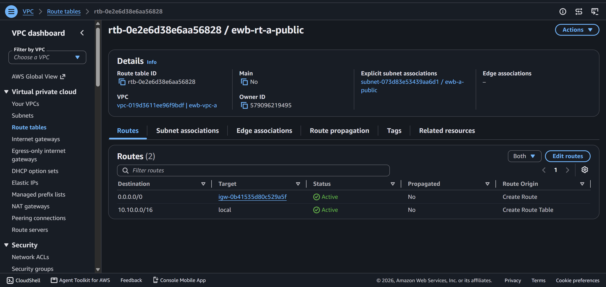
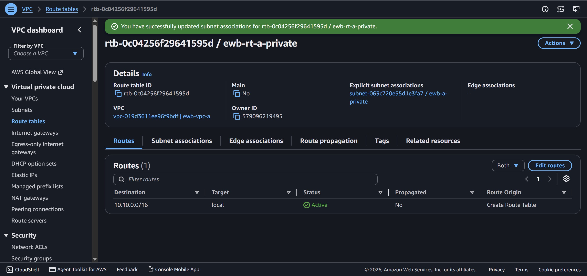

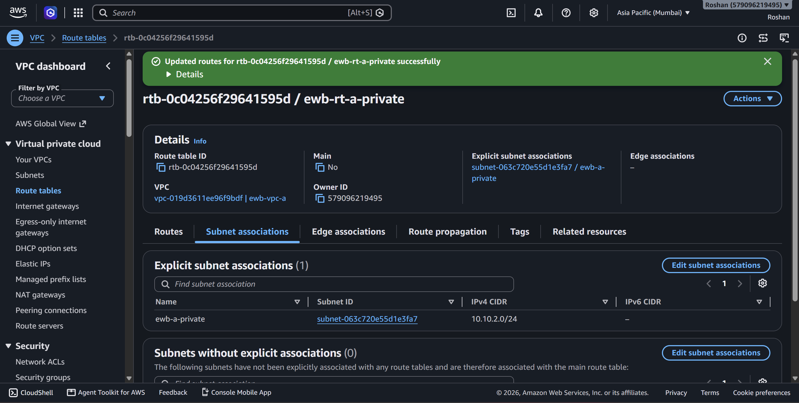
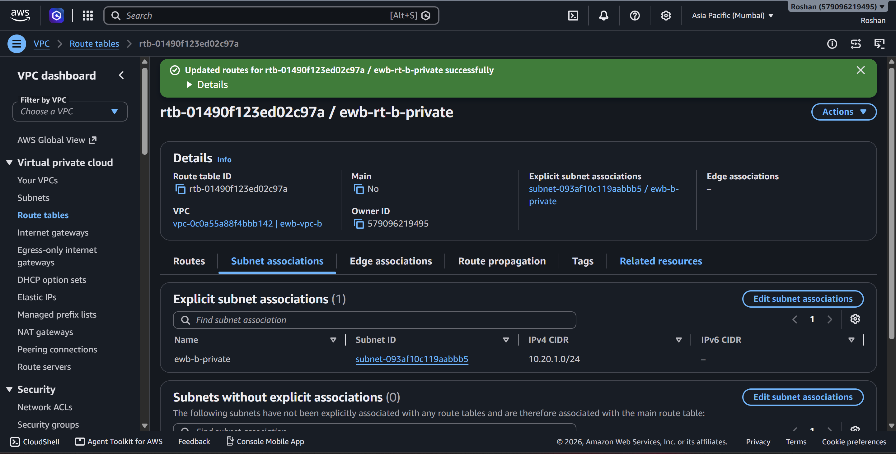
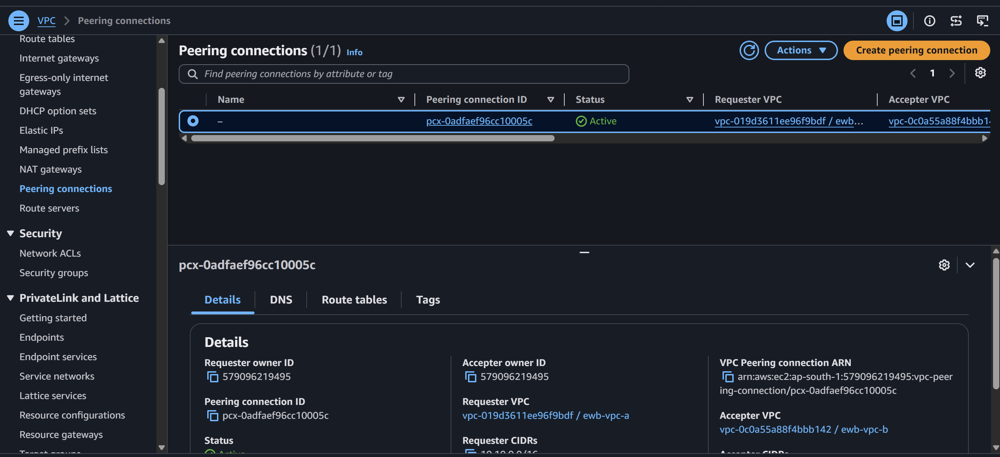
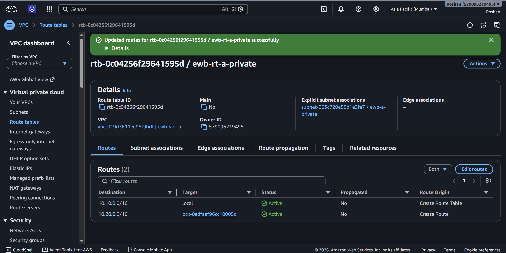
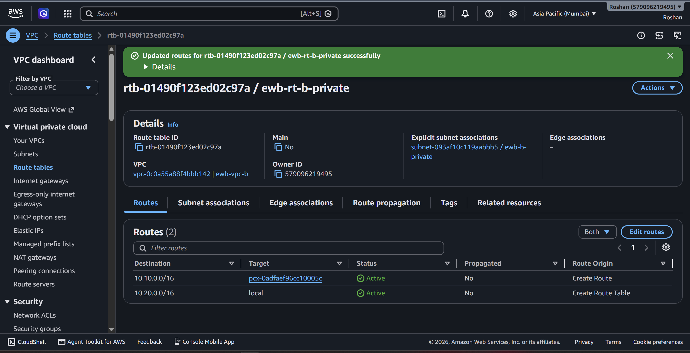
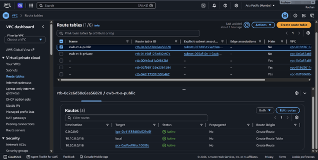

Security groups
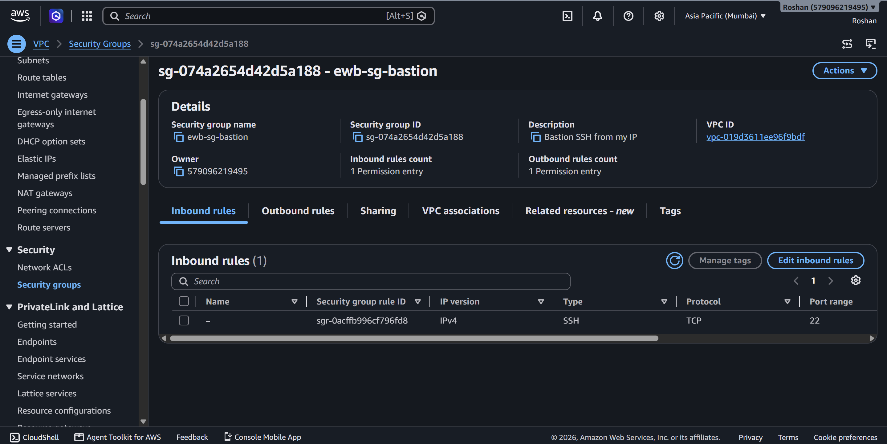
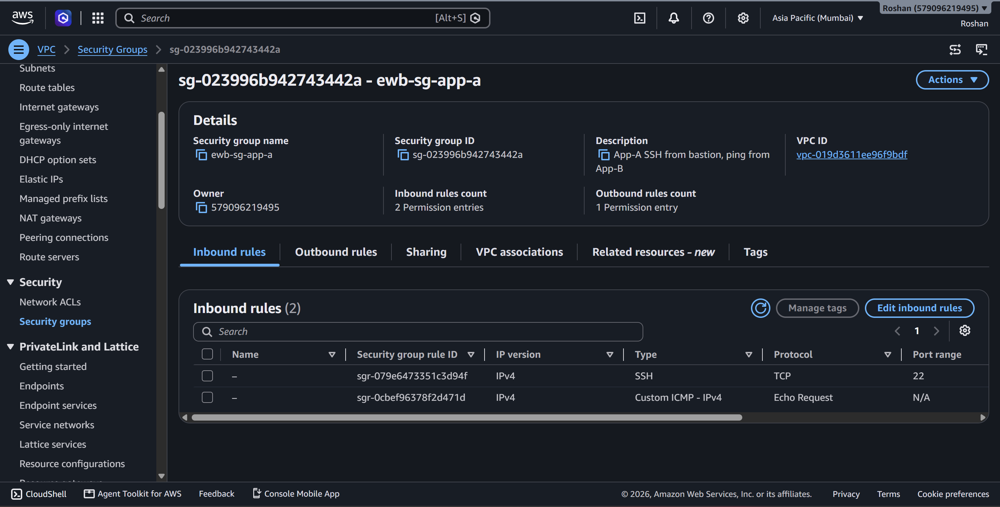
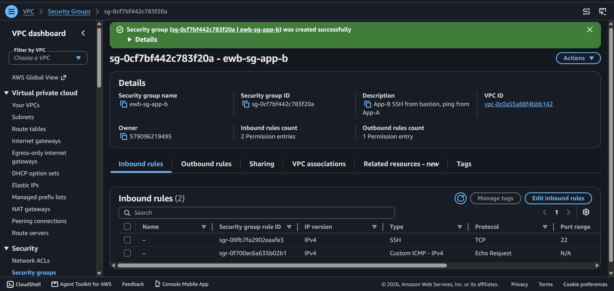

Tests
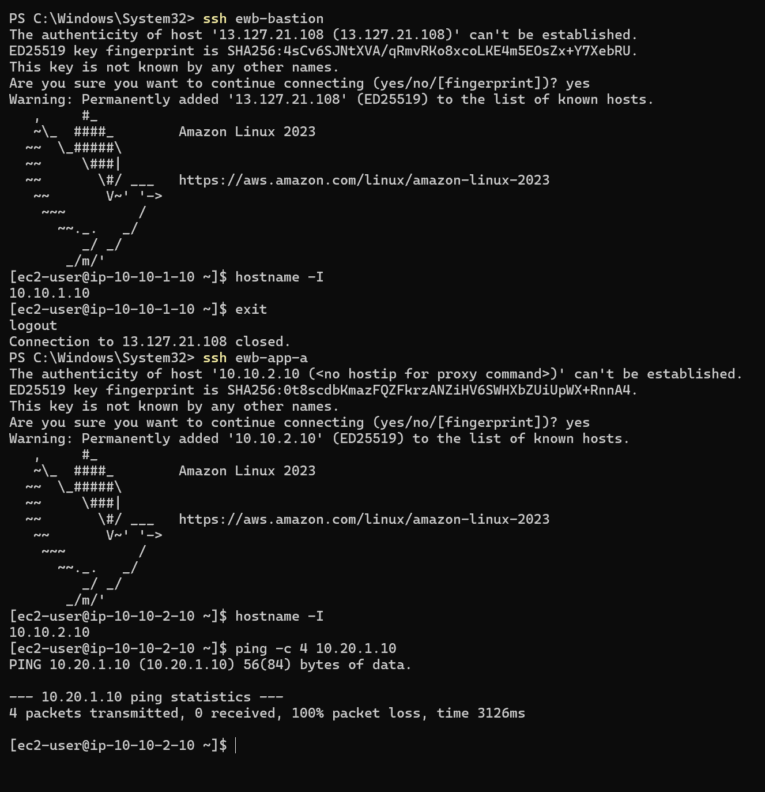
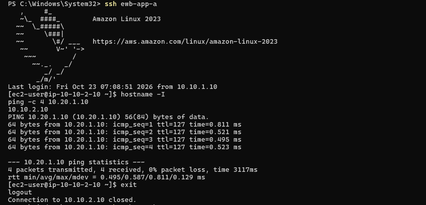
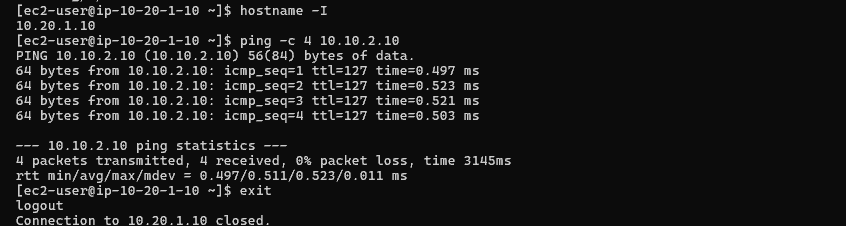
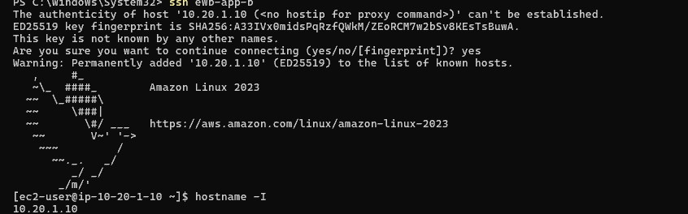
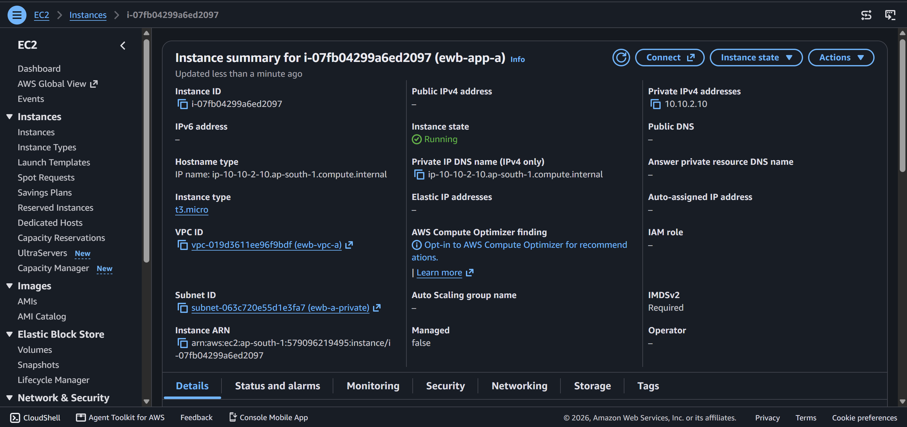
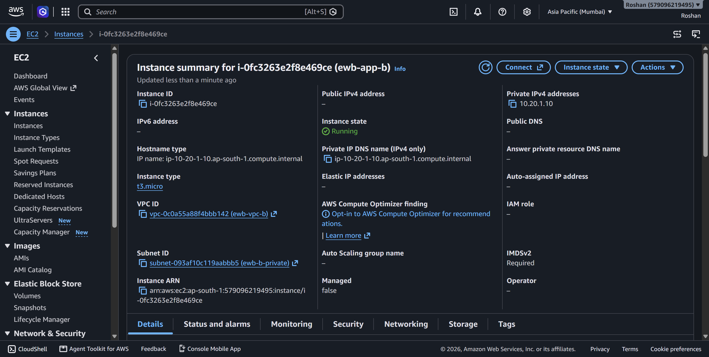
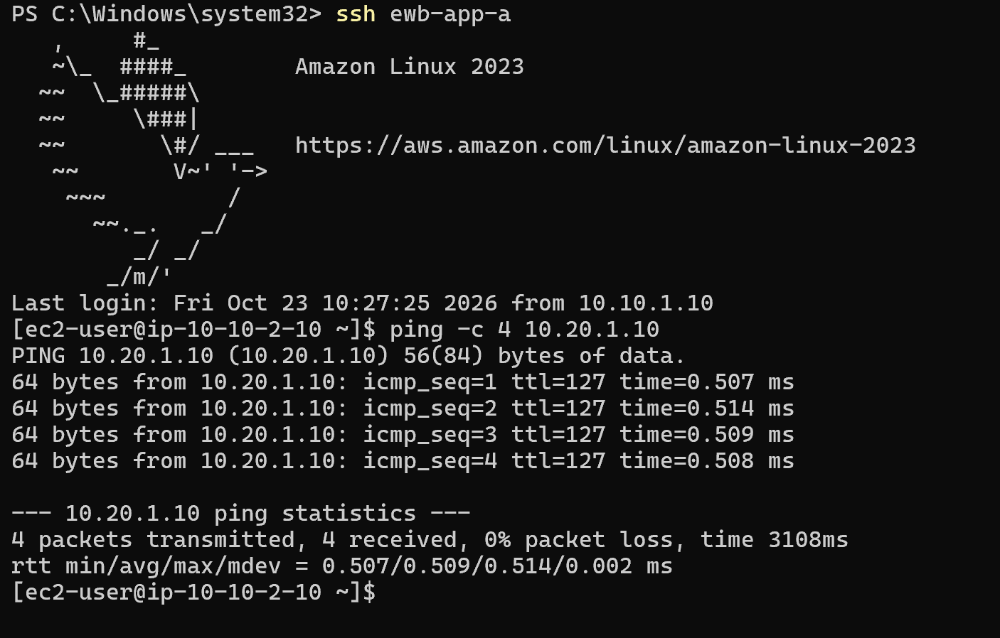
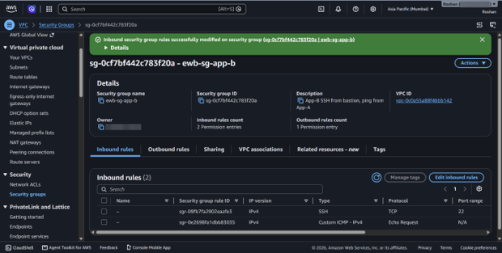

## Cleanup

All resources were deleted after the project to avoid charges.